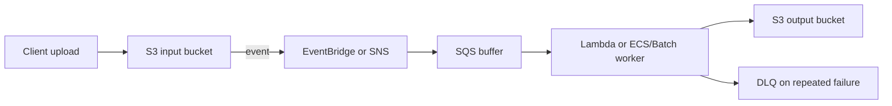

# Event-driven file processing

S3 owns the durable file. The event layer distributes/filter-routes the notification. SQS absorbs bursts and permits retries independent of the upload. Pick Lambda for short conversion tasks, ECS/Batch for heavy or long-running work. Keep input and output prefixes/buckets distinct, and make the worker idempotent because events can be delivered more than once.
