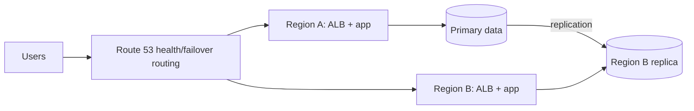

# Multi-region disaster recovery

The DNS policy directs users toward the healthy region. Replication choice determines RPO: asynchronous cross-region replication can lose the most recent updates during a regional failure. The standby region's active capacity determines RTO: backup/restore is slowest, pilot light/warm standby faster, and active-active fastest/costliest. Test data promotion and application dependency failover, not just DNS.
