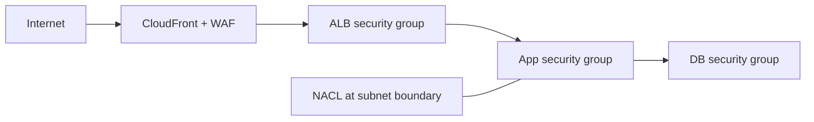

# Network filtering choices

- **WAF** examines web requests and can block by IP, rate, or attack signature before they reach the origin.
- **Security groups** express permitted application flows, e.g. ALB SG to app SG on port 443 and app SG to DB SG on 5432.
- **NACLs** apply to all subnet traffic, can explicitly deny, and require both directions/ephemeral ports due to stateless behavior.

Use the narrowest control that matches the requirement: WAF for L7 HTTP policy, SGs for stateful workload reachability, and NACLs for subnet-wide stateless controls.
