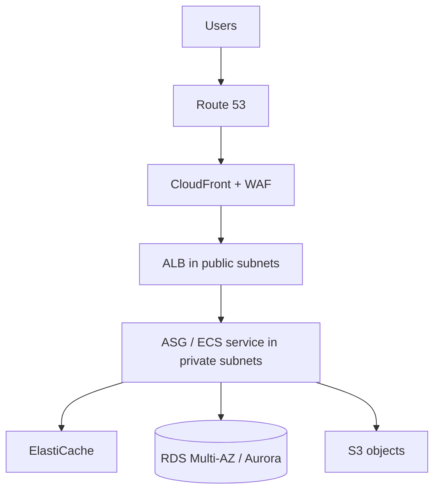

# Three-tier highly available web application

## How to read it

1. Route 53 resolves the service name; CloudFront serves cacheable assets close to users and WAF screens HTTP requests.
2. The ALB is the regional HTTP entry point. Its public subnets are not the application servers' subnets.
3. App capacity spans AZs. Instances/tasks are replaceable and use roles, not embedded credentials.
4. ElastiCache absorbs hot reads or stores sessions. RDS/Aurora remains the durable relational system of record.
5. S3 holds objects such as uploads/static assets, avoiding local disk dependence.

The availability property comes from removing single-instance dependencies and using multi-AZ tiers, not merely from adding an Elastic IP.
