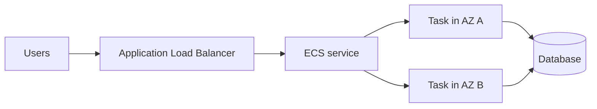

# Containers: ECR, ECS, EKS and Fargate

## Roles

| Service | What it is | Main decision |
|---|---|---|
| ECR | private container image registry | store and scan images close to AWS compute |
| ECS | AWS-native container orchestrator | want managed orchestration with low operational overhead |
| EKS | managed Kubernetes control plane | need Kubernetes APIs/ecosystem or portability |
| Fargate | serverless compute for ECS/EKS tasks/pods | do not want to manage worker instances |

## ECS building blocks

- **Cluster**: logical capacity boundary.
- **Task definition**: the immutable blueprint: image, CPU/memory, ports, IAM role, logging, volumes.
- **Task**: a running copy of the definition.
- **Service**: keeps the desired number of tasks running and integrates with load balancers.
- **Capacity providers / launch type**: choose EC2 capacity you operate or Fargate capacity AWS operates.

## ECS launch types

| Type | Best for | Trade-off |
|---|---|---|
| ECS on EC2 | specialized instances, GPUs, daemon-like agents, maximum packing control | manage EC2 fleet, AMIs, capacity, patching |
| Fargate | straightforward services/jobs and isolated task billing | less host control; supported shapes/features define limits |
| Fargate Spot | interruption-tolerant tasks | tasks may be reclaimed |

## Architecture

The load balancer owns the public entry point and routes only to healthy tasks. ECS replaces failed tasks; spreading tasks across AZs prevents one AZ failure from removing all capacity. Store state outside the task because task replacement is expected.

## Exam distinctions

- ECR stores images; it does not schedule them.
- ECS is not Kubernetes; EKS is the managed Kubernetes option.
- Fargate removes node management, not the need to design task networking, IAM, observability, and persistent data.
