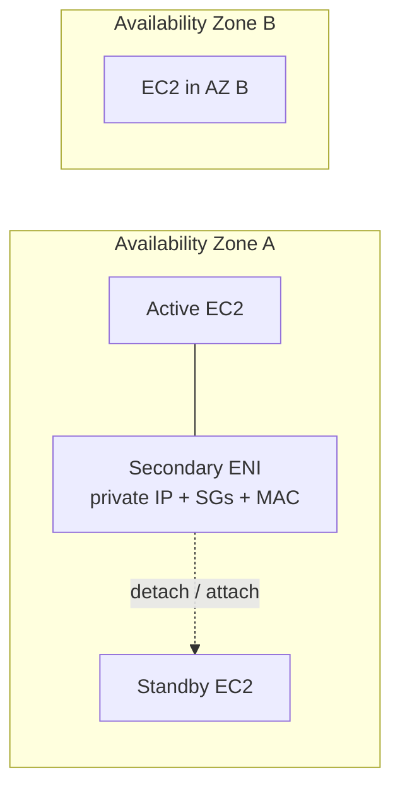
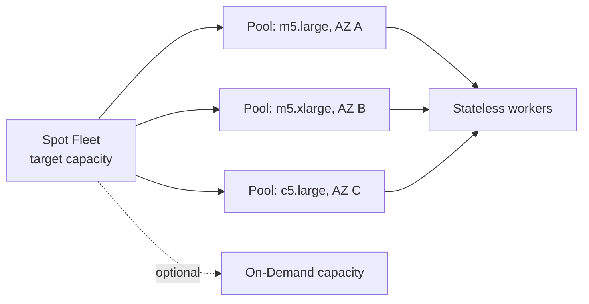

# Amazon EC2

## Introduction

EC2 is an IaaS virtual-machine service. You choose an AMI, instance type, storage, network placement, security group, and purchasing model. Choose it when you need OS-level control, a long-running process, specialized hardware, or a workload that does not fit a managed runtime.

## Instance families

| Need | Family idea | Typical examples |
|---|---|---|
| Balanced CPU, memory, network | General purpose | web servers, development |
| High CPU | Compute optimized | batch, transcoding, game servers |
| Large in-memory working set | Memory optimized | caches, analytics, relational databases |
| High local sequential I/O | Storage optimized | distributed file systems, data warehouses |
| Accelerators | GPU / inference | graphics, ML, HPC |

## Lifecycle and placement

- Stop/start preserves EBS-backed disk but normally changes the public IPv4 address. Hibernation also preserves RAM and is supported only by eligible configurations.
- Termination destroys the instance; the root EBS volume follows its `DeleteOnTermination` setting.
- An ENI is a movable virtual network card. It can hold private IPs, an Elastic IP association, security groups, and a MAC address.
- An Elastic IP is a static public IPv4 address that can be remapped during recovery; prefer load balancers or DNS for normal HA.

## EC2 Hibernate

Hibernate saves the instance's RAM contents to its encrypted EBS root volume,
then stops the instance. On the next start, EC2 reloads memory and resumes the
previously running processes. Use it when an application has a slow bootstrap
or expensive in-memory warm-up and must resume faster than a normal stop/start.

| State change | RAM | EBS volumes | Public IPv4 |
|---|---|---|---|
| Stop/start | discarded | retained | normally changes |
| Hibernate/start | saved to the encrypted root EBS volume and restored | retained | normally changes |
| Terminate | discarded | root volume follows `DeleteOnTermination` | released |

Hibernation must be enabled **when the instance launches**; it cannot be
turned on later for an existing instance. It requires a supported HVM AMI and
instance type, an **encrypted EBS root volume** large enough to hold RAM, and
a supported EBS volume type. The instance remains stopped while hibernated, so
there is no running-instance charge, but EBS storage—including the saved RAM—is
billed. Attached EBS volumes persist; instance-store data does not.

**Exam signals:** choose hibernation for preserving application memory and
process state. Do not choose it merely to preserve an EBS disk—that is already
handled by a normal stop/start. A hibernated instance keeps its private IP and
Elastic IP association, but a non-Elastic public IPv4 is released.

## Elastic Network Interfaces (ENIs)

An Elastic Network Interface is the logical network card for a resource in a VPC. Every EC2 instance has a primary ENI (`eth0`) created with it. You can create a secondary ENI independently, configure it, then attach or detach it while the architecture needs it.

| ENI attribute | Notes |
|---|---|
| Private IPv4 | one primary private IPv4 and optionally secondary private IPv4 addresses |
| Public / Elastic IPv4 | a public IPv4 or Elastic IP association is mapped through a private IPv4 address; an Elastic IP can be remapped during recovery |
| IPv6 | one or more IPv6 addresses when the subnet/VPC supports IPv6 |
| Security groups | one or more stateful firewall groups are associated with the ENI |
| MAC address | stays with the ENI, which is useful when the network identity must move |

### Scope and failover

**An ENI is bound to one Availability Zone.** It can be attached only to an EC2 instance in that same AZ; it cannot be moved to an EC2 instance in another AZ. An ENI can move between compatible instances **within its AZ**, which is useful for a same-AZ failover design where an IP address, security-group attachment, and MAC address need to move together.

The ENI may move from `Active EC2` to `Standby EC2`, but both are in AZ A. `Other` cannot receive that ENI. For multi-AZ availability, use a regional entry point such as an ALB, Route 53 failover, or a service with built-in multi-AZ failover rather than relying on ENI movement.

## Purchasing decision

| Model | Choose when | Do not choose when |
|---|---|---|
| On-Demand | short, unpredictable workload | steady committed demand |
| Savings Plan | predictable spend with flexibility | usage is likely to disappear |
| Reserved Instance | stable instance/region commitment, especially capacity or licensing needs | you need broad instance flexibility |
| Spot | interruption-tolerant batch, stateless workers, flexible fleets | a single non-interruptible worker |
| Capacity Reservation | capacity must exist in a specific AZ now | the aim is only a discount |
| Dedicated Host | host-level licensing or compliance | tenancy isolation alone is enough |

## Spot Fleet

A Spot Fleet requests a target amount of compute from a set of eligible **launch pools**. A launch pool is defined by choices such as instance type, Availability Zone, operating system, and capacity characteristics. The fleet can use Spot capacity and, when configured, On-Demand capacity to reach its target.

Using multiple pools is the core resilience technique: a fleet has more places to obtain capacity when one instance type or AZ is constrained. The fleet stops launching when it meets the target capacity or reaches its configured maximum cost/capacity limit. It does not make a Spot workload interruption-proof - every application still needs checkpointing, idempotency, and a plan for the two-minute interruption notice.

| Allocation strategy | What it favors | Good fit |
|---|---|---|
| `lowestPrice` | lowest-priced eligible pool | short, cost-first, interruption-tolerant work |
| `diversified` | spread across all eligible pools | availability through diversification, long-running flexible work |
| `capacityOptimized` | pools with the best available Spot capacity | reduce interruption risk from scarce pools |
| `priceCapacityOptimized` | high available capacity, then lower price | recommended general starting point for flexible Spot workloads |

The diagram shows capacity selection, not traffic routing. The fleet chooses among its configured pools according to the allocation strategy, then launches workers. Keep work outside the instance: use an SQS/Kinesis queue, S3 inputs/outputs, checkpoints, and retry-safe processing.

### Spot Fleet vs. Auto Scaling group

An Auto Scaling group maintains a chosen fleet of EC2 instances in response to desired capacity, schedules, or metrics; it is the usual answer for a continuously running application tier behind a load balancer. A Spot Fleet is designed to acquire a target amount of flexible Spot capacity across pools. They can be complementary, but neither replaces application-level interruption handling.

## Design signals

- Put replaceable instances in an Auto Scaling group across AZs; put durable state in managed storage/database services.
- Use user data / AMIs for repeatable bootstrapping, but keep startup fast enough for scaling.
- Security groups are stateful, allow-only firewalls attached to ENIs. Referencing a source security group expresses "app tier may reach DB tier" better than IP ranges.
