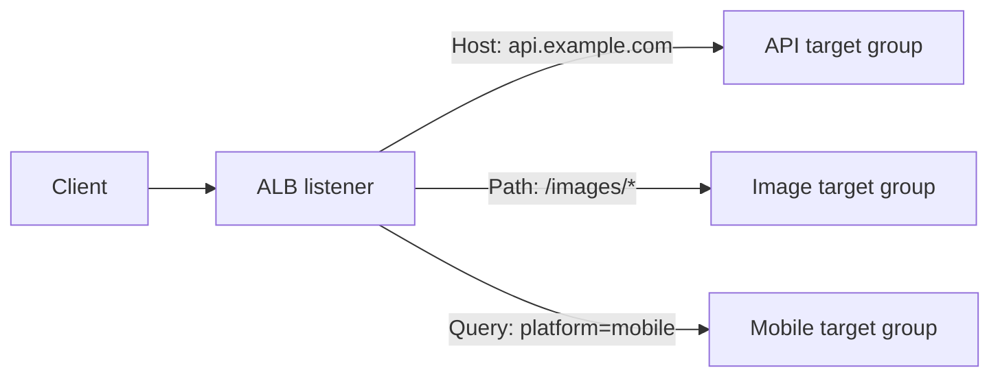
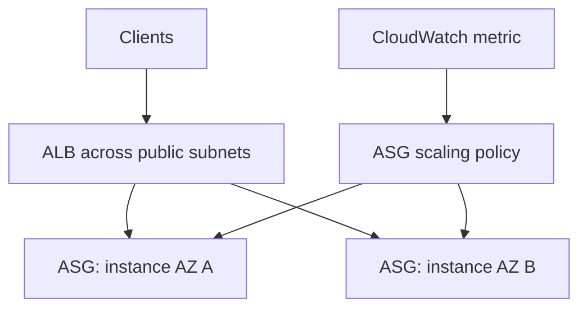

# Elastic Load Balancing and Auto Scaling

## Load balancers

| Type | Layer / protocol | Use when |
|---|---|---|
| ALB | Layer 7 HTTP/HTTPS | host/path/header/query routing, microservices, WebSockets, HTTP targets including Lambda/ECS |
| NLB | Layer 4 TCP/UDP/TLS | very high performance, static IPs, source IP preservation, non-HTTP traffic |
| GWLB | Layer 3/4 service insertion | transparently route flows through fleets of firewalls or appliances |

ALB and NLB are regional services designed for multi-AZ targets. Health checks decide which targets receive new traffic. Deregistration delay lets in-flight requests finish during deployment or scale-in.

## Application Load Balancer routing and addressing

An ALB listener evaluates ordered rules and forwards a matching HTTP(S) request to a target group. The rule can route based on:

- host header, such as `api.example.com` versus `shop.example.com`
- URL path, such as `/images/*` versus `/api/*`
- HTTP request method
- HTTP headers
- query strings / parameters, such as `?platform=mobile`
- source IP address

**Exam distinction:** attaching an Elastic IP is not a listener routing condition. An ALB does not support Elastic IP addresses; it exposes AWS-managed dynamic IPs behind its DNS name. When a question requires static IP addresses or source-IP preservation at the load balancer, evaluate an NLB instead.

## Server Name Indication (SNI)

**SNI** is a TLS extension in which the client supplies the hostname it wants
before the TLS session is established. It lets one secure listener on one IP
address present the right certificate for multiple domains, such as
`api.example.com` and `shop.example.com`.

- An **ALB HTTPS listener** and an **NLB TLS listener** can have a default
  certificate plus additional certificates in a certificate list. When a
  client sends SNI, the load balancer selects the matching certificate.
- A client that does not send SNI, or sends a hostname with no matching
  certificate, receives the listener's default certificate.
- SNI chooses the certificate during the TLS handshake. ALB host-based rules
  then route the decrypted HTTP request; SNI is not a substitute for those
  routing rules.
- Use a wildcard or SAN certificate when it covers the required names. A
  Classic Load Balancer does not support SNI.

**Exam signal:** several HTTPS/TLS domains on the same listener, each needing
its own certificate, points to a certificate list with SNI support—not a
separate load balancer for every domain.

## Auto Scaling groups (ASG)

An ASG maintains desired capacity between minimum and maximum bounds. It replaces unhealthy instances and can span AZs. Attach it to an ELB so ELB health can inform replacement.

| Policy | Best framing |
|---|---|
| Target tracking | keep a metric near a target (for example, average CPU) |
| Step / simple | react by different amounts to alarm severity |
| Scheduled | known recurring schedule |
| Predictive | forecast recurring demand |

### Target tracking with an ALB

Use a **Target Tracking Scaling Policy** when the requirement says to keep a metric around a value. For an ALB-backed ASG, `ALBRequestCountPerTarget` can target an average request count per healthy target. A target value of **1000** means the ASG scales to keep that metric close to 1,000 requests per target.

| Requirement wording | Best policy |
|---|---|
| "Keep average requests per target around 1,000" | Target tracking using `ALBRequestCountPerTarget` with target `1000` |
| "CPU exceeds 70%, add two instances" | Step/simple scaling with a CloudWatch alarm |
| "Scale before Friday evening traffic" | Scheduled scaling |
| "Forecast recurring demand" | Predictive scaling |

The course-style question sometimes says "connections" informally, but `ALBRequestCountPerTarget` is a **request-count** metric. Answer Target Tracking when the intent is to maintain a per-target ALB workload level around a specified value.

## Diagram explained

The ALB gives one DNS endpoint and stops routing to unhealthy instances. The ASG adds/replaces instances in response to desired capacity or metrics. These are complementary: the load balancer distributes requests; the ASG supplies healthy compute.
