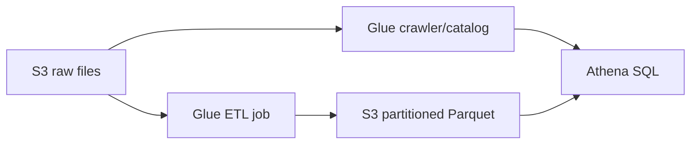

# Athena and Glue

## Amazon Athena

Athena is serverless SQL query over data in S3. It is a strong fit for occasional/ad-hoc analysis, log analytics, audit queries, and data-lake exploration without provisioning a database cluster. Query cost relates to data scanned, so use columnar formats (Parquet/ORC), compression, partitioning, and narrow projections to reduce scan volume.

Athena needs metadata describing the files. That metadata commonly comes from the Glue Data Catalog. It is not a transactional database and does not make raw CSV logs magically cheap to query.

## AWS Glue

Glue provides managed data integration. Important parts are:

- **Data Catalog**: central metadata store of databases, tables, partitions, and schemas, used by Athena, Glue, EMR, Redshift Spectrum and others.
- **Crawler**: discovers files/data stores and infers catalog tables/partitions. Review inferred schema rather than assuming it is correct.
- **ETL job**: serverless Spark/Python processing to clean, transform, join, or convert data, typically reading/writing S3.
- **DataBrew**: visual/no-code data preparation use cases.

The raw zone preserves source data. ETL produces a curated columnar/partitioned layer. Athena uses the catalog to map SQL tables to the curated files.

## Glue job bookmarks

Use **Glue job bookmarks** for a scheduled batch ETL job that should process only data that is new since its last successful run. Glue persists state for supported sources and transformations, preventing old input from being processed again and helping avoid duplicate output.

- Set the job bookmark option to **enable** for normal incremental processing. **Disable** rereads the full input; **pause** can process a defined historical range without advancing the saved bookmark, which is useful for a backfill.
- In a script-based job, call `job.init(...)` at the start and `job.commit()` after a successful run. Glue updates bookmark state at commit time.
- Attach a `transformation_ctx` to the source/transform calls whose state Glue should track. For JDBC sources, use a strictly monotonic bookmark key when Glue cannot use a suitable key automatically.
- Bookmarks are state tracking, not a universal de-duplication guarantee. Design the target write to be idempotent when retries or changed source files could produce duplicates.

**Exam cue:** “track data already processed by a previous Glue ETL run” points to **Glue job bookmarks**, not a crawler, Data Catalog, DataBrew, or a streaming checkpoint.

See the [AWS Glue job bookmarks documentation](https://docs.aws.amazon.com/glue/latest/dg/monitor-continuations.html) for supported sources and formats.
