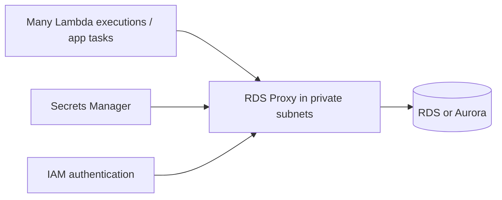

# RDS Proxy, database security and connection design

Amazon RDS Proxy is a managed, highly available connection pool/proxy for supported RDS and Aurora engines. It lives in your VPC and is never publicly accessible. Applications connect to the proxy endpoint; the proxy maintains/reuses a smaller pool of database connections to the target database.

## Why it matters

Opening a database connection is expensive. A burst of Lambda executions or many short-lived application processes can exhaust database connections or consume CPU/memory before the database can do useful query work. RDS Proxy pools and shares connections, smooths this pressure, and can preserve client connections through a failover, reducing application disruption.

The key is that thousands of short-lived clients need not produce thousands of simultaneous database connections. The client and proxy must share VPC network reachability; the proxy-to-DB security group path must be allowed.

## Decision table

| Requirement | Choice |
|---|---|
| direct DB connection count is stable and low | connect to RDS/Aurora directly |
| Lambda/serverless burst opens too many connections | RDS Proxy |
| improve connection handling during RDS/Aurora failover | RDS Proxy |
| cache reads / session data | ElastiCache, not RDS Proxy |
| change SQL engine or run read analytics | RDS/Aurora features or a separate analytics design, not RDS Proxy |

## Identity, secrets, and events

RDS Proxy can retrieve credentials from Secrets Manager and enforce IAM database authentication for supported engines. This centralizes secret rotation and avoids distributing credentials into every function/container. It does not eliminate database authorization design: database users, IAM policies, KMS permissions for secret access, security groups, and VPC placement must all align.

RDS event notifications report resource lifecycle/operational events - DB instance, snapshot, parameter/security group, RDS Proxy, and custom-engine events - to SNS or EventBridge. They do not contain table-row changes; use application logic, CDC, or a suitable data integration mechanism for that.
