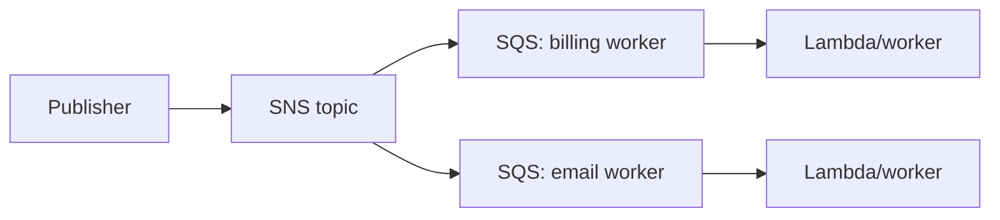

# SQS, SNS and EventBridge

| Service | Model | Best fit |
|---|---|---|
| SQS Standard | pull queue, at-least-once, best-effort order | decouple workers, high throughput |
| SQS FIFO | queue with ordering/deduplication semantics | strict ordered message groups / exactly-once processing goal |
| SNS | push pub/sub topic | fan out one event to many subscribers |
| EventBridge | event bus with rules and event patterns | route AWS/SaaS/custom events with rich filtering |

## Reliability vocabulary

Use a DLQ to isolate messages/events that repeatedly fail. Set SQS visibility timeout greater than consumer processing time; it is not a retention period. Consumers must be idempotent because Standard queues and downstream delivery can repeat work.

This fan-out pattern gives each consumer its own queue and retry pace. One slow or failed consumer does not block the other, unlike having both compete for messages in one queue.
