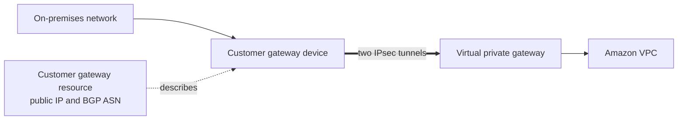

# VPC connectivity

| Option | Topology / use | Key constraint |
|---|---|---|
| VPC peering | direct private VPC-to-VPC link | non-transitive; CIDRs cannot overlap |
| Transit Gateway | hub-and-spoke for many VPCs and on-premises networks | central routing and attachment design needed |
| Site-to-Site VPN | encrypted connection over internet | fast to establish; throughput/latency depend on internet and design |
| Direct Connect | dedicated private connection to AWS | takes provisioning time; traffic is private but add VPN/MACsec when encryption requirement applies |
| PrivateLink | privately expose/consume a service | service-level, not general routed network connectivity |

## Site-to-Site VPN building blocks

| Component | Where it lives | Purpose |
|---|---|---|
| Customer gateway device | on premises | Physical or software router that you configure to terminate the VPN |
| Customer gateway (CGW) resource | AWS account | Describes the device to AWS, including its external IP address and BGP ASN; it does not configure the device |
| Virtual private gateway (VGW) | AWS, attached to one VPC | AWS-side VPN or Direct Connect endpoint for a VPC |
| Transit gateway (TGW) | AWS regional network hub | AWS-side VPN target when many VPCs or on-premises networks need centralized, transitive routing |
| VPN connection | between the customer and AWS gateways | Provides two redundant IPsec tunnels over the internet |

Each Site-to-Site VPN connection has two tunnels with separate AWS endpoints. Configure both tunnels because AWS may replace or maintain one endpoint and route traffic through the other. A second customer gateway device and VPN connection can remove the remaining on-premises-device single point of failure.

The internet gateway and NAT gateway are not the endpoints of a Site-to-Site VPN. The exam pairing for a VPN into one VPC is **customer gateway + virtual private gateway**. For a hub connecting many VPCs, the AWS-side target is normally a transit gateway instead.

## VPN routing

| Routing mode | Behavior | Best signal |
|---|---|---|
| Dynamic | BGP exchanges routes between the customer gateway device and AWS; both sides use ASNs | preferred when the device supports BGP and routes can change |
| Static | Remote network prefixes are entered manually | simple devices or fixed, small route sets |

Traffic needs routes in both directions. With a VGW, enable route propagation on the relevant VPC subnet route tables or add routes whose target is the VGW. With a TGW, the VPC subnet route table must target the TGW, and the TGW route table must connect the VPC and VPN attachments. Avoid overlapping VPC and on-premises CIDR ranges.

## Gateway distinctions

| Gateway | Remember it as |
|---|---|
| Internet gateway | public internet path for a VPC |
| NAT gateway | outbound IPv4 translation for private subnets |
| Virtual private gateway | VPN/Direct Connect endpoint attached to a VPC |
| Customer gateway | AWS representation of the customer-side VPN device |
| Transit gateway | regional routing hub for many VPCs, VPNs, and Direct Connect connectivity |
| Direct Connect gateway | links Direct Connect virtual interfaces to associated VGWs or TGWs, including supported cross-Region designs |

Site-to-Site VPN connects networks; Client VPN connects individual users. Direct Connect supplies a dedicated private path but does not automatically encrypt traffic, so use an applicable encryption option when encryption in transit is required. A Site-to-Site VPN is also a common cost-effective backup for Direct Connect.

Use VPC Flow Logs to investigate accepted/rejected IP traffic (not every application-level reason). Route 53 Resolver endpoints handle DNS resolution between VPCs and on-premises networks.
