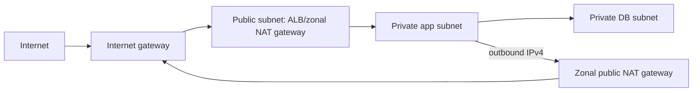

# Amazon VPC

A VPC is a regional isolated virtual network. Subnets are confined to one AZ. A public subnet has a route to an internet gateway; a private subnet does not automatically mean it has no outbound access - it can route outbound IPv4 through NAT.

## Traffic controls

| Control | Attached to | Stateful? | Rules |
|---|---|---|---|
| Security group | ENI/resource | yes | allow only |
| Network ACL | subnet boundary | no | ordered allow and deny |
| Route table | subnet/gateway | n/a | selects next hop |

Because a NACL is stateless, both request and response (ephemeral) ports must be allowed. Security group return traffic is automatically allowed for an established permitted flow.

## Egress and private AWS access

- **Internet Gateway**: enables internet routing for public IPv4/IPv6 resources when route and public address conditions are met.
- **NAT Gateway**: managed IPv4 NAT. A zonal public NAT gateway normally sits in a public subnet; deploy one per active AZ for zone-independent egress. A regional public NAT gateway expands across AZs automatically and does not require a public subnet.
- **Egress-only IGW**: IPv6 outbound-only equivalent; IPv6 addresses are globally routable.
- **Gateway endpoint**: route-table based private access to S3 or DynamoDB; no per-hour endpoint charge.
- **Interface endpoint (PrivateLink)**: private ENI-based access to many AWS/partner services; has endpoint cost and needs DNS/security-group design.

## NAT gateway vs NAT instance

Both options let private-subnet resources initiate IPv4 connections without accepting unsolicited inbound internet connections. The main difference is whether AWS or you operate the NAT device.

| Attribute | NAT gateway | NAT instance |
|---|---|---|
| Management | AWS managed; no operating-system patching | Self-managed EC2 instance and NAT software |
| Availability | Zonal gateways are redundant within an AZ; use one per AZ for zone independence. Regional gateways provide managed multi-AZ expansion | One instance is a single point of failure unless you build monitoring and failover |
| Scaling | Automatically scales; no instance type to select | Limited by the selected EC2 instance; resize or scale the design yourself |
| Security groups | Cannot attach a security group; control clients with their security groups and the NAT subnet with a NACL | Has security groups, in addition to subnet NACLs |
| Source/destination check | No configuration required | Must be disabled because the instance forwards traffic that is not addressed to itself |
| Custom behavior | No port forwarding and cannot serve as a bastion host | Can run custom firewall/proxy software, port forwarding, or act as a bastion |
| Cost model | Gateway-hour and data-processing charges | EC2 instance, storage, and data-transfer charges plus administration |
| Normal exam choice | Preferred for managed, scalable, production egress | Choose only when the question requires instance-level customization or explicitly favors a small self-managed design |

### Zonal NAT routing pattern

For a zonal public NAT gateway, the private subnet sends `0.0.0.0/0` to the NAT gateway. The NAT gateway is in a public subnet whose route table sends `0.0.0.0/0` to an internet gateway, and the NAT gateway uses an Elastic IP address. Keep the private workload and its NAT gateway in the same AZ to avoid an AZ dependency and unnecessary cross-AZ traffic.

A NAT instance follows the same public/private subnet route pattern, but the private route targets the instance or its network interface. The instance needs a public IPv4 address or Elastic IP, appropriate security-group rules, IP forwarding/NAT configuration, and source/destination checking disabled.

### Fast decision rules

- **Managed, highly available, automatically scaling** -> NAT gateway.
- **Custom firewall, proxy, packet handling, port forwarding, or bastion behavior** -> NAT instance.
- **Private access to S3 or DynamoDB without NAT processing charges** -> gateway VPC endpoint, not either NAT option.
- **IPv6 outbound-only internet access** -> egress-only internet gateway, not IPv4 NAT.
- **One zonal NAT gateway serving several AZs** can work, but creates a zonal dependency and cross-AZ traffic; use one per AZ or evaluate a regional NAT gateway for resilient public egress.

## Diagram explained

Only the public tier accepts unsolicited internet traffic. The private app tier receives traffic through the load balancer and may initiate outbound updates through NAT. The DB tier has no direct internet path; security-group references restrict it to the app tier.
