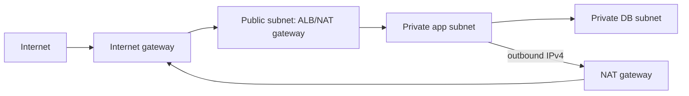

# Amazon VPC

A VPC is a regional isolated virtual network. Subnets are confined to one AZ. A public subnet has a route to an internet gateway; a private subnet does not automatically mean it has no outbound access - it can route outbound IPv4 through NAT.

## Traffic controls

| Control | Attached to | Stateful? | Rules |
|---|---|---|---|
| Security group | ENI/resource | yes | allow only |
| Network ACL | subnet boundary | no | ordered allow and deny |
| Route table | subnet/gateway | n/a | selects next hop |

Because a NACL is stateless, both request and response (ephemeral) ports must be allowed. Security group return traffic is automatically allowed for an established permitted flow.

## Egress and private AWS access

- **Internet Gateway**: enables internet routing for public IPv4/IPv6 resources when route and public address conditions are met.
- **NAT Gateway**: permits private IPv4 resources to initiate internet/AWS public-service connections; deploy per AZ for resilient zonal egress designs.
- **Egress-only IGW**: IPv6 outbound-only equivalent; IPv6 addresses are globally routable.
- **Gateway endpoint**: route-table based private access to S3 or DynamoDB; no per-hour endpoint charge.
- **Interface endpoint (PrivateLink)**: private ENI-based access to many AWS/partner services; has endpoint cost and needs DNS/security-group design.

## Diagram explained

Only the public tier accepts unsolicited internet traffic. The private app tier receives traffic through the load balancer and may initiate outbound updates through NAT. The DB tier has no direct internet path; security-group references restrict it to the app tier.
