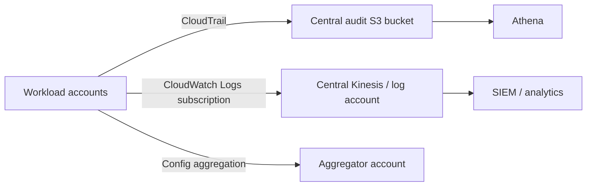

# Observability: CloudWatch, logs, X-Ray, CloudTrail and Config

Observability answers different questions that are often conflated in exam scenarios:

| Question | Primary service |
|---|---|
| Is the workload healthy or fast enough? | CloudWatch metrics, dashboards, alarms |
| What did the application or host write? | CloudWatch Logs |
| Which request caused latency across services? | X-Ray / distributed tracing |
| Who made an AWS API call or changed a resource? | CloudTrail |
| What configuration existed, and did it meet a rule? | AWS Config |

## Amazon CloudWatch metrics and alarms

AWS services publish metrics to namespaces. A metric is a time series identified by its name and dimensions, such as an EC2 `CPUUtilization` metric for one instance. Standard metrics are normally coarse-grained; publish a custom metric when application knowledge matters - queue depth, orders/minute, or active users, for example.

An alarm evaluates a statistic over one or more periods and moves between `OK`, `ALARM`, and `INSUFFICIENT_DATA`. It can notify SNS, execute an Auto Scaling policy, or recover/reboot/stop/terminate eligible EC2 instances. A composite alarm combines other alarm states with AND/OR logic, which helps reduce paging noise.

Use the EC2 `StatusCheckFailed_System` signal for underlying-host failure and EC2 recovery; an application process crash needs an application/health-check signal instead. Build dashboards for correlated signals - request rate, errors, latency, saturation - rather than alerting only on CPU.

## CloudWatch Logs

CloudWatch Logs stores timestamped events in **log groups**, divided into **log streams**. Set retention deliberately; otherwise operational data can accumulate indefinitely. Sources include Lambda, API Gateway, ECS, VPC Flow Logs, CloudTrail, and the CloudWatch agent.

- EC2 does **not** send operating-system/application logs automatically. Install/configure the CloudWatch Unified Agent and give its instance role permission to publish.
- The Unified Agent can collect system metrics unavailable by default, including memory, processes, disk usage/I/O, swap, and detailed network data; it can also send log files. Its configuration can be centralized in Parameter Store.
- A metric filter turns matching log text into a CloudWatch metric. Pair it with an alarm for patterns such as repeated errors.
- Logs Insights is an interactive query language for logs in CloudWatch Logs. Use it for ad-hoc incident investigation; it does not replace a long-term data lake/query workflow.
- Subscription filters continuously forward matching log events to Lambda, Kinesis Data Streams, Kinesis Data Firehose, or a cross-account destination. Use this for central analysis or streaming processing, not as a one-time export.

## CloudWatch operational insights

| Feature | Use it for |
|---|---|
| Container Insights | aggregated container metrics/logs for ECS, EKS, Kubernetes, Fargate |
| Lambda Insights | CPU, memory, disk/network and cold-start diagnostics for Lambda |
| Contributor Insights | top-N contributors in logs/metrics, such as busiest IPs or noisiest URLs |
| Application Insights | automated application dashboards/findings for supported workloads |
| Synthetics canaries | scripted outside-in checks of endpoints/workflows |
| Network Synthetic Monitor | packet loss, latency, and jitter on private hybrid paths |

## AWS X-Ray

X-Ray traces a request through instrumented services. A trace contains segments/subsegments, letting you find which downstream call consumes time or fails. Use it for distributed latency/error diagnosis across API Gateway, Lambda, EC2/ECS applications and supported integrations. CloudWatch tells you **that** latency rose; tracing helps show **where** it happened.

## AWS CloudTrail

CloudTrail is the AWS API audit trail: console actions, CLI/SDK calls, and service-originated API activity. Event history is available by default for recent management events. Create a trail to deliver events to S3 for longer retention, optionally CloudWatch Logs for monitoring/querying, and configure all-regions coverage to avoid regional blind spots.

| Event type | Meaning | Default trail behavior |
|---|---|---|
| Management event | control-plane action such as `CreateSubnet` or IAM policy change | logged |
| Data event | high-volume resource operation, such as S3 object access or Lambda invocation | opt in |
| Insights event | unusual management write-event patterns | opt in |

CloudTrail Insights baselines management write events and can surface anomalous API activity. It can emit an EventBridge event, enabling automated notification/remediation. For long-term audit analytics, store trails in S3 and query them with Athena.

## AWS Config

Config records resource configuration and changes over time, then evaluates resources against managed or custom Config rules. It is regional but can aggregate across accounts/regions. It answers "was this security group open yesterday?" and "is every load balancer configured with a certificate?"

Config Rules report compliance; they do **not** prevent an action. Pair a rule with SSM Automation remediation or EventBridge/SNS notification when you need correction. Do not confuse Config with CloudTrail: Config tells you the resource state/timeline; CloudTrail attributes the API call that made the change.

## Central logging pattern

Use Organizations to standardize trails and central destinations. Separate security/audit accounts from workload accounts and protect central buckets with restrictive policies and retention controls.
