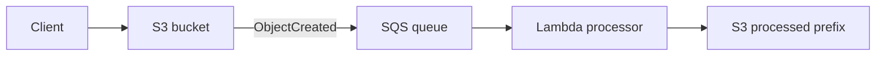

# Amazon S3

S3 is regional object storage. Buckets hold objects addressed by key; an object is not a block device or POSIX file system. It is the default answer for durable, massively scalable object storage, static content, data lakes, backups, and event-driven file workflows.

## Storage classes

| Class | Use when | Retrieval profile |
|---|---|---|
| Standard | frequently accessed data | immediate |
| Intelligent-Tiering | access pattern unknown/changing | automatic tiering |
| Standard-IA / One Zone-IA | infrequent data, immediate retrieval | IA trades storage price for access/retrieval cost; One Zone sacrifices AZ resilience |
| Glacier Instant / Flexible / Deep Archive | archives | progressively slower/cheaper retrieval choices |

Use lifecycle rules to transition or expire objects. Versioning protects against overwrite/delete; MFA Delete adds protection for version deletion. Replication is asynchronous and needs versioning; CRR is cross-region and SRR is same-region.

## Security and delivery

- Block Public Access is the broad guardrail. Bucket policy is resource-based; IAM policy is identity-based; ACLs are generally legacy/minimal-use.
- SSE-S3, SSE-KMS, SSE-C, and client-side encryption protect data at rest. SSE-KMS adds KMS permissions and request/cost considerations.
- Presigned URLs grant time-limited access without making an object public.
- S3 event notifications can target SNS, SQS, or Lambda; EventBridge offers richer filtering and destinations.

### SSE-C: server-side encryption with customer-provided keys

With **SSE-C**, the client supplies its own AES-256 encryption key in each S3 request. S3 performs the encryption when storing the object and decryption when retrieving it, but **never stores the supplied key**. The client must provide the same key for every read, metadata, copy, and multipart-upload request; losing the key means the object cannot be recovered.

- Use HTTPS only. The key is sent with the request, so sending it over HTTP compromises it.
- The client, not S3 or KMS, owns key storage, rotation, and the mapping between every object version and its key.
- SSE-C is an object-level option, not a bucket default encryption method. It is not supported in the S3 console and is difficult to use with other users, roles, or AWS services because they would also need the customer-supplied key.
- SSE-C is disabled by default for new general-purpose buckets. A workload that genuinely requires it must explicitly permit it in the bucket encryption configuration before SSE-C write requests will succeed.

For most modern workloads, prefer **SSE-S3** for simple S3-managed encryption or **SSE-KMS** when you need KMS policies, auditability, and AWS-service integration. SSE-C is server-side encryption, not client-side encryption: S3 still encrypts and decrypts the data, while the customer retains the key material.

**Exam cue:** choose **SSE-C** only when the requirement specifically says that the customer supplies and manages the encryption key but wants S3 to perform encryption. Choose client-side encryption when encryption must happen before data reaches S3.

See the [AWS SSE-C documentation](https://docs.aws.amazon.com/AmazonS3/latest/userguide/ServerSideEncryptionCustomerKeys.html).

## S3 Object Lock

**S3 Object Lock** provides write-once-read-many (WORM) protection for an **object version**. Use it when records must not be deleted or overwritten for a retention period, such as regulatory archives, audit evidence, or ransomware recovery data. Object Lock requires S3 Versioning; once enabled on a bucket, it cannot be disabled and versioning cannot be suspended.

Object Lock has two retention modes:

| Mode | Protection | Best fit |
|---|---|---|
| **Governance** | Most users cannot change or delete the protected version. A specifically authorized principal can bypass it with `s3:BypassGovernanceRetention` and an explicit bypass request. | Guardrails where designated administrators need an emergency override. |
| **Compliance** | No principal, including the account root user, can overwrite or delete the protected version or shorten its retention period before the retain-until date. | Regulatory WORM retention with no administrative override. |

A retention period can be **fixed**, with an explicit retain-until date, or **variable**, where an event hold delays setting the final date until the hold is released. Set a default retention configuration on the bucket when new object versions should receive a standard mode and period automatically.

A **legal hold** is separate from retention modes. It protects an individual object version indefinitely until an authorized user explicitly removes it. A version can have both a legal hold and a retention period; removing one does not remove the other.

Object Lock protects the specified version, not its object key forever: a new upload with the same key creates a new version, and a delete marker can still be added. The protected version remains immutable until its retention and any legal hold are released.

**Exam cue:** choose **compliance mode** when even administrators must not delete data before a fixed date. Choose **governance mode** when protected data needs an authorized bypass path. Choose a **legal hold** when the end date is unknown, for example during litigation or an audit.

See [AWS documentation for S3 Object Lock](https://docs.aws.amazon.com/AmazonS3/latest/userguide/object-lock.html).

## Diagram explained: upload pipeline

The bucket persists the input. SQS decouples arrival rate from processing and buffers spikes. Lambda pulls queued work and writes a separate output prefix, avoiding recursive event loops. Configure idempotent processing because delivery can be duplicated.
